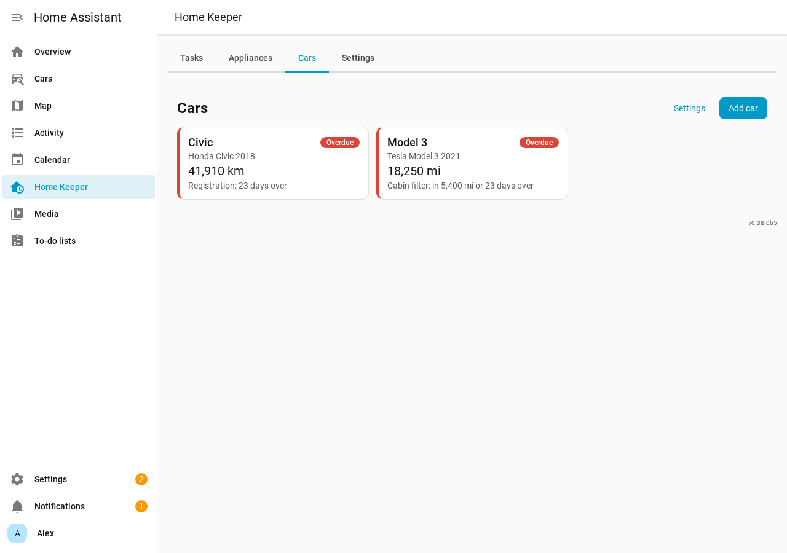
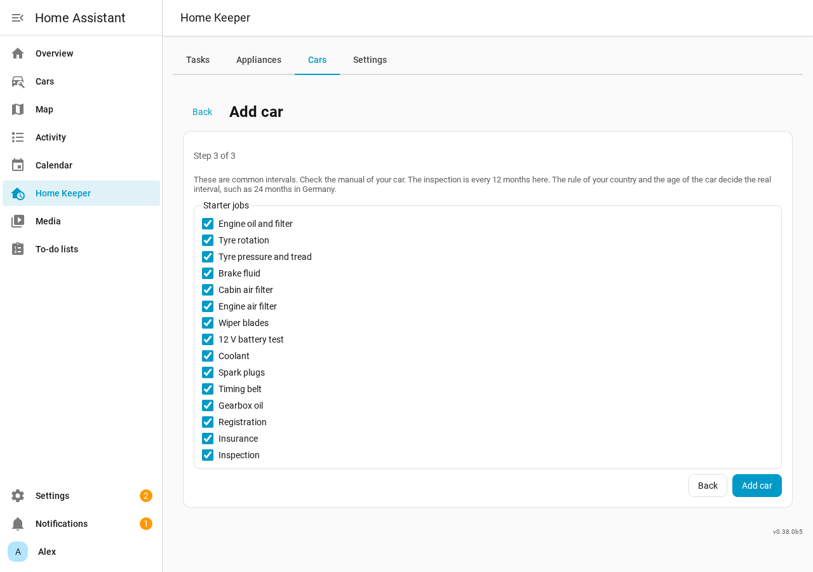
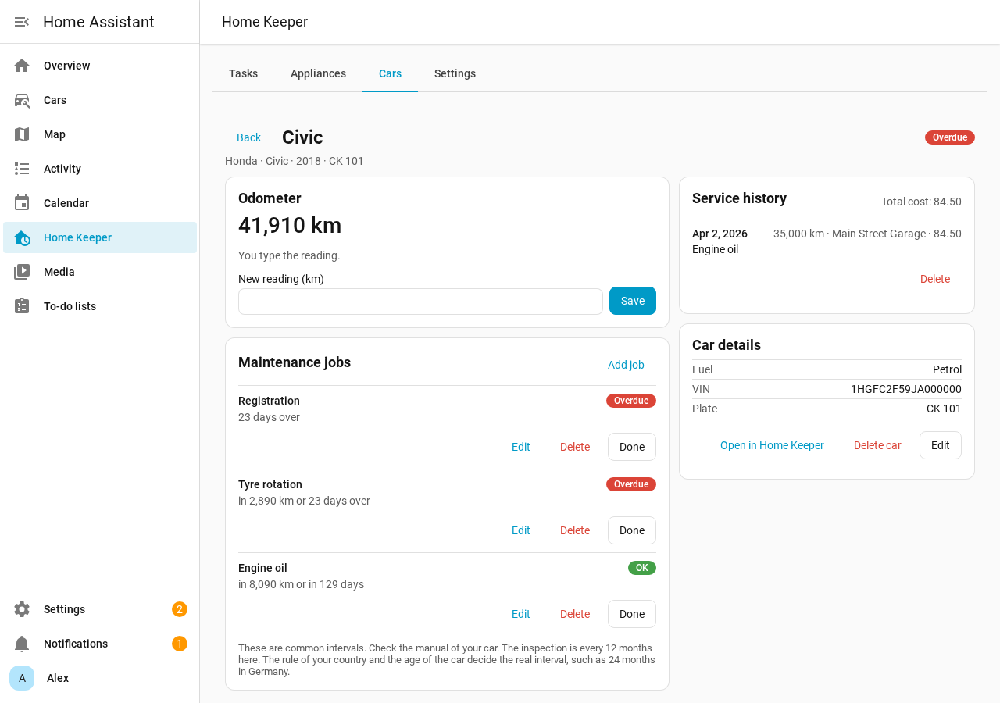

# Garage and cars

The **Cars** tab of the Home Keeper panel shows each car of the household. Only an admin
sees the tab. Open it at **Home Keeper > Cars**.

Each car shows its odometer, its status and its next job. The status is the worst status
of its jobs:

| Status | Meaning |
|---|---|
| **OK** | No job is due. |
| **Due soon** | A job is inside its warning window. |
| **Overdue** | A job is at or past a limit. |

## Add a car

1. Select **Add car**.
2. Type the name. The other fields are optional, such as the VIN and the plate. Select
   **Next**.
3. Type the odometer reading now. You can connect a sensor later. Select **Next**.
4. Select the starter jobs. Car Keeper offers the common jobs of the fuel type. Check the
   manual of your car, because these are common intervals, not the schedule of the maker.
   The inspection repeats every 12 months, the shortest common rule. Your country and the
   age of the car decide the real interval, such as 24 months in Germany. Change it in
   **Settings** or on the job.
5. Select **Add car**.

A car with no timing belt has a timing chain. Clear **Timing belt** for that car.

## Car details

The page of a car has the odometer, the jobs, the service history and the car details.
Select **Edit** in **Car details** to change a field. A car also has the engine code,
the transmission code and the date of its first registration.

**Open in Home Keeper** opens the appliance of the car in Home Keeper. Its parts and its
stock are there.

## Delete a car

Select **Delete car**. Car Keeper asks first, because there is no undo. The delete removes
the jobs, the service history and the readings of the car. The Home Keeper appliance
stays, with its parts and its stock.
