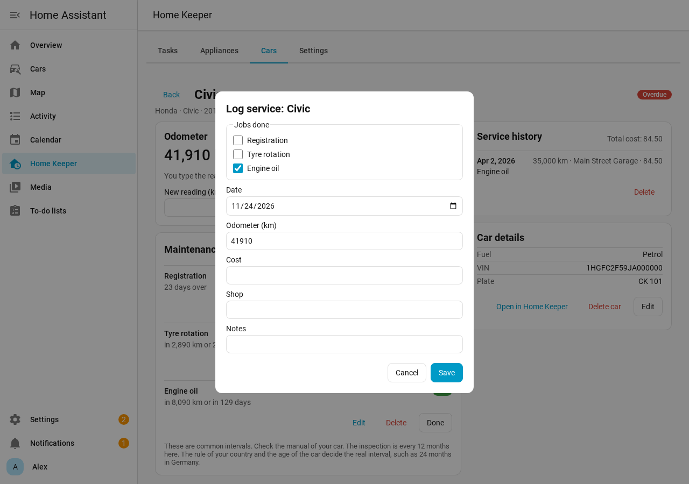

# Jobs and service log

A job is a maintenance item of a car, such as an oil change. Its interval is a distance,
a time or both. It is due at the limit that comes first.

## When a job is due

Each job counts from the last service that did it. With no service yet, it counts from
the date and the reading that you give, else from today and the odometer of today.

Car Keeper warns you before a limit. The warning window is 1,000 km (600 miles) or 30
days, and you can change it for each car or job.

A date job, such as the registration, is due at a date. A service near the date moves the
job to the next year.

## Add or edit a job

On the page of a car, select **Add job**, or **Edit** on a job. Give a name and an
interval. **Make a Home Keeper task** puts the job in Home Keeper with its reminders.
Clear **On** to keep a job with no reminders.

## Log a service

Select **Done** on a job. The dialog selects that job. Select the other jobs of the same
visit, and give the date, the reading, the cost and the shop.

Every Home Assistant user can log a service. The to-do list of a car also logs a
service when a user checks a job.

## Service history

The service history shows each service of the car, the newest first, with the total cost.
Only an admin can delete a service. Car Keeper asks first. The delete also removes the
Home Keeper completion, and the parts go back to the stock.
