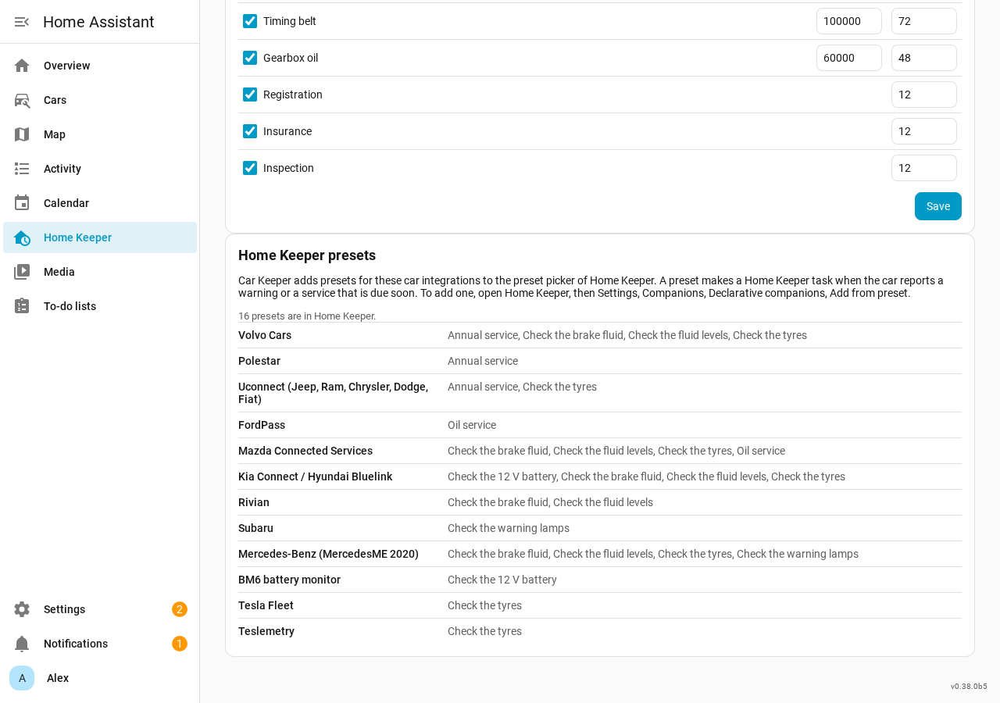
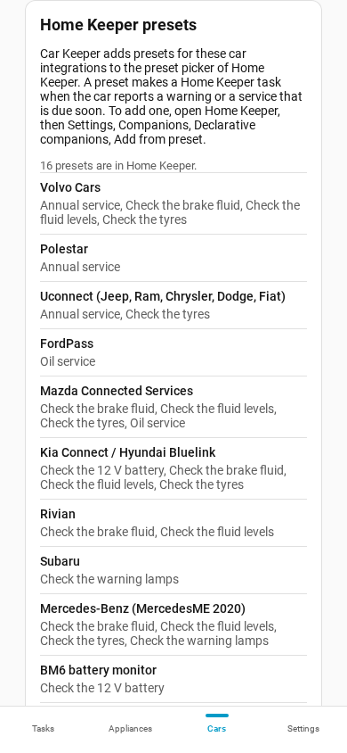

# Home Keeper presets for car integrations

Many car integrations report when the car needs work, such as the days to the next
service or a low brake fluid warning. Car Keeper adds presets for these
integrations to the preset picker of Home Keeper. A preset makes a Home Keeper task for
each car that reports a warning or a service that is due soon. Home Keeper closes the task
when the warning stops.

## What you need

- Home Keeper 0.38.0b5 or later. An older Home Keeper cannot take presets from a
  companion. Car Keeper then shows this on its settings page, and all its other functions
  work.
- A car integration from the list below, set up in Home Assistant.

## See the presets

Open the Cars tab, then **Settings**. The **Home Keeper presets** section shows:

- the status: how many presets are in Home Keeper, or why there are none;
- each car integration, and the tasks that its presets can make.

## Add a preset

1. Open Home Keeper, then **Settings**, **Companions**.
2. Under **Declarative companions**, select **Add from preset**.
3. Find the preset of your car integration. The preset shows that Car Keeper provides it.
4. Check the entities that it matches, then save.

Home Keeper makes 1 task for each matched entity. To stop the tasks, delete the
declarative companion in Home Keeper.

## The integrations

| Integration | Tasks |
|---|---|
| Volvo Cars | Annual service, fluid levels, brake fluid, tyres |
| Polestar | Annual service |
| Uconnect (Jeep, Ram, Chrysler, Dodge, Fiat) | Annual service, tyres |
| FordPass | Oil service |
| Mazda Connected Services | Oil service, fluid levels, brake fluid, tyres |
| Kia Connect / Hyundai Bluelink | Fluid levels, brake fluid, tyres, 12 V battery |
| Rivian | Brake fluid, fluid levels |
| Subaru | Warning lamps |
| Mercedes-Benz (MercedesME 2020) | Fluid levels, brake fluid, tyres, warning lamps |
| BM6 battery monitor | 12 V battery |
| Tesla Fleet, Teslemetry | Tyres |

| Preset | Opens its task |
|---|---|
| Service | 14 days before the service |
| Oil life | Below 10% |
| Warning | While the warning is on |

Some integrations turn off their warning entities by default: the Subaru warning lamps
and the Tesla tyre warnings. Turn the entity on in Home Assistant first.

## The jobs of Car Keeper and the presets

The jobs of Car Keeper use the odometer and the time: "every 15,000 km or 12 months".
A preset uses what the car reports. Use a job for the oil change and a preset for the
brake fluid warning on the same car.

## When there are no presets

| Status | What to do |
|---|---|
| Your Home Keeper cannot take presets | Update Home Keeper to 0.38.0b5 or later. |
| Home Keeper refused the presets | Open an issue on Car Keeper with the message. |
| Car Keeper is sending the presets | Wait a few seconds. Home Keeper must be set up. |
