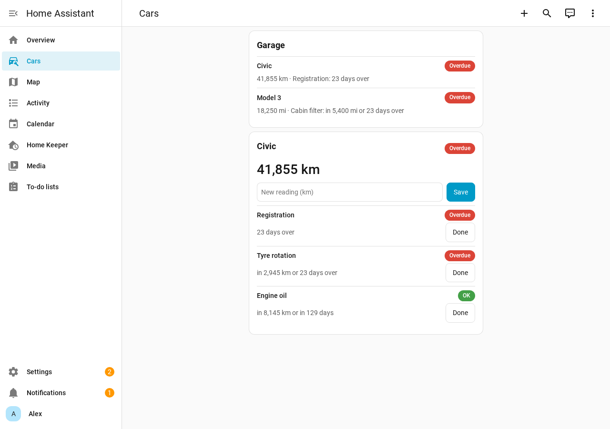

# Dashboard cards

Car Keeper has 2 cards for a dashboard. Every Home Assistant user can use them.



## Garage card

The garage card shows each car with its odometer, its status and its next job.

```yaml
type: custom:car-keeper-garage-card
title: Our cars
```

## Car card

The car card shows 1 car with its jobs. A user can type a reading and mark a job done
there. The card has no other control.

```yaml
type: custom:car-keeper-car-card
car_id: 0a1b2c3d4e5f
max_height: 320
```

Find the `car_id` in the address of the page of the car: `/home-keeper/cars/car/<car_id>`.

## Options

| Option | Card | Meaning |
|---|---|---|
| `title` | Both | The title. The default is "Garage", or the name of the car. |
| `car_id` | Car card | The car to show. |
| `max_height` | Both | A height in pixels. Above it, the list scrolls inside the card. With no `max_height`, the card grows with its content. |
